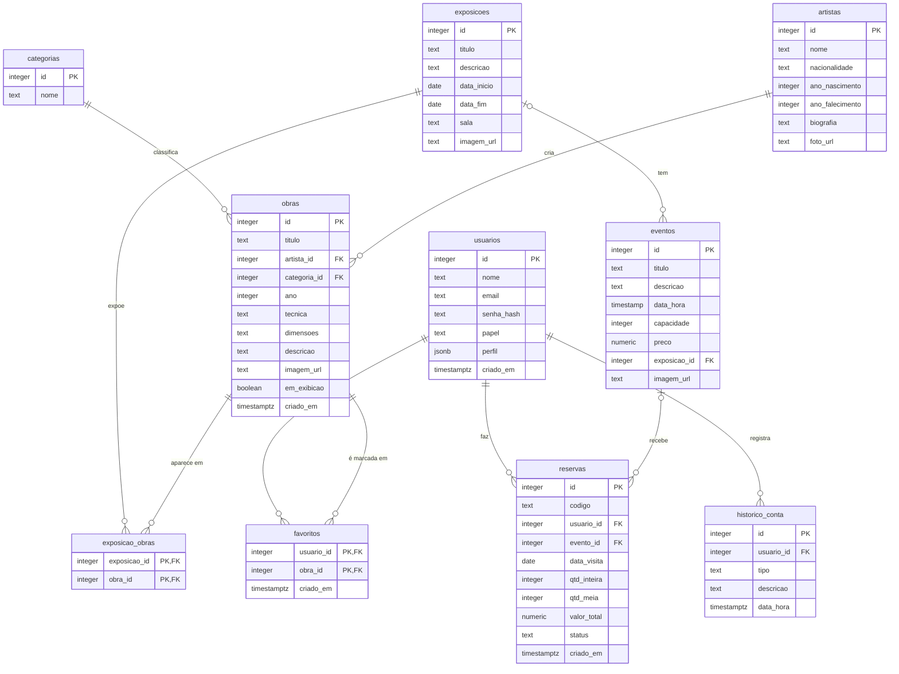

<!-- Responsável: M1 — atualize ao mudar uma tabela na sua migration -->

# Diagrama do banco

O GitHub desenha o diagrama abaixo sozinho. Ele mostra as tabelas de dados do museu; ficam de fora a `sessoes` (logins, gerida pelo `connect-pg-simple`) e a `migracoes` (controle do `npm run db:migrar`).

## O que cada tabela guarda

| Tabela | Guarda | Dono | Migration |
| --- | --- | --- | --- |
| `categorias` | Tipos de obra (Pintura, Escultura...). Uma categoria tem várias obras. | M4 | `010_acervo.sql` |
| `artistas` | Artistas do acervo, com biografia e foto. Um artista tem várias obras. | M4 | `010_acervo.sql` |
| `obras` | Obras do acervo, inclusive as criadas no Admin. | M4 | `010_acervo.sql` |
| `exposicoes` | Exposições com período (`data_inicio` a `data_fim`) e sala. | M5 | `020_agenda.sql` |
| `exposicao_obras` | Quais obras estão em cada exposição (ligação N–N). | M5 | `020_agenda.sql` |
| `eventos` | Visitas guiadas, oficinas e palestras, com capacidade e preço; podem pertencer a uma exposição. | M5 | `020_agenda.sql` |
| `usuarios` | Contas de visitantes e do admin, com senha em hash (bcrypt) e as preferências do perfil (`perfil`, em JSON). | M7 | `030_conta.sql` |
| `favoritos` | Obras favoritadas por cada usuário (ligação N–N). | M7 | `030_conta.sql` |
| `historico_conta` | Ações da conta mostradas no perfil (cadastro, login, favoritos...). | M7 | `030_conta.sql` |
| `reservas` | Ingressos reservados: visita comum (sem evento) ou de um evento, com código `MUS-XXXXX`. | M6 | `040_reservas.sql` |

`data_hora` dos eventos é `timestamp` sem fuso: guarda a hora local do museu (Brasília). Compare-a com `LOCALTIMESTAMP` ou `CURRENT_DATE`, nunca com `now()`.
